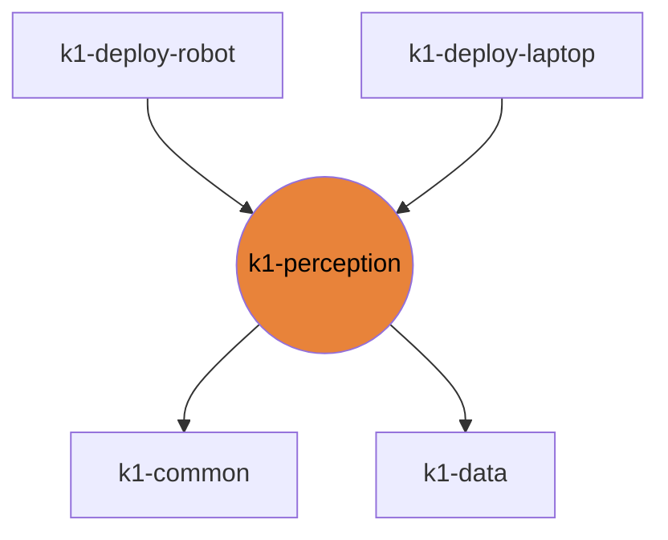

# k1-perception

SLAM chain: cuVSLAM, TCP relay, nvblox stream, grid map.

| | |
|---|---|
| Layer | **L2**: Domain (no cross-imports) |
| May import | [k1-common](https://github.com/thdhyan/k1-common), [k1-data](https://github.com/thdhyan/k1-data) |
| Files / LOC | 20 files · 1,274 lines (py, sh, cpp) |
| Part of | [k1-workspace](https://github.com/thdhyan/k1-workspace) (architecture and layering rules live there) |

## Where it sits



Used by: k1-deploy-robot, k1-deploy-laptop.


## Install

Not an installable library: clone it and run the scripts in place.
```bash
git clone https://github.com/thdhyan/k1-perception
```

## Usage

SLAM chain for the K1 head cameras. Not an installable library: run the scripts in place.

- `real_robot/slam_onboard/`: cuVSLAM node, TCP relay, nvblox stream and grid map on the robot. `laptop_rviz.sh`
  and `laptop_nvblox.sh` are the laptop viewers. Meshes come from k1-description (`K1_ASSETS_DIR` overrides).
- `real_robot/slam_dl/`: the same SLAM in a container on `dl`.
- `real_robot/map_run/record_rgbd.py`: RGB-D recorder.

Runbook: `docs/legacy/k1_slam_runbook.md` in k1-workspace. Robot addresses: [docs/ROBOTS.md](https://github.com/thdhyan/k1-workspace/blob/main/docs/ROBOTS.md).

## Tests

No tests yet.

## Robots and hosts

Robot IPs, SSH aliases, network, safety and how to control each robot: [docs/ROBOTS.md](https://github.com/thdhyan/k1-workspace/blob/main/docs/ROBOTS.md) in k1-workspace.

## Environment variables read

`K1_ASSETS_DIR`, `K1_VIZ_DOMAIN`

## Layout

```
README.md
pyproject.toml
real_robot/  (24 files)
  README.md
  map_run/  (1 files)
  slam_dl/  (4 files)
  slam_onboard/  (15 files)
  slam_runs/  (1 files)
  urdf/  (1 files)
```

## Dependencies

- Declared sibling libraries: k1-common, k1-data (see `pyproject.toml`, `[tool.uv.sources]`).
- PyPI: matplotlib, numpy, opencv-python, scipy.
- Provided by the environment (ROS 2, Isaac, mjlab, robot SDK) or unresolved: `builtin_interfaces`, `cuvslam`, `geometry_msgs`, `nav_msgs`, `rclpy`, `rosidl_runtime_py`, `sensor_msgs`, `std_msgs`, `tf2_msgs`, `tf2_ros`, `visualization_msgs`.

## Hard-coded paths into other repos

These files still name paths that now live in another repo (hard-coded path strings, not imports). Pass them as arguments / config when you touch the file:

| File | Refers to | Owner |
|---|---|---|
| `real_robot/slam_onboard/README.md` | `real_robot/` | k1-data |
| `real_robot/slam_onboard/k1_cuvslam_node.py` | `real_robot/` | k1-data |
| `real_robot/slam_onboard/laptop_nvblox.sh` | `real_robot/` | k1-data |
| `real_robot/slam_onboard/laptop_rviz.sh` | `real_robot/` | k1-data |
| `real_robot/slam_onboard/run_slam.sh` | `real_robot/` | k1-data |

## Origin

Extracted from `booster_ws` (branch `dev/push-training-wip`, working tree of 2026-11-03) by
`tools/build_workspace.py` in k1-workspace. Old path to new path for every file: [`docs/migration_map.tsv`](https://github.com/thdhyan/k1-workspace/blob/main/docs/migration_map.tsv) (filter on `k1-perception`).
History was not carried over: the working tree was copied as is, including previously untracked files.
